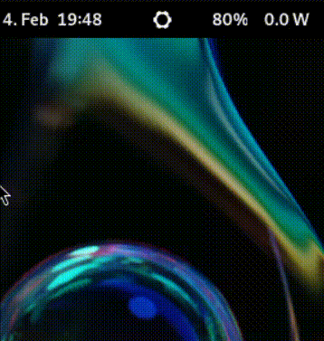

# frameworkd
daemon to control system settings of your [Framework](https://frame.work/de/en) laptop.

It provides a d-bus service based on [FrameworkComputer/framework-system](https://github.com/FrameworkComputer/framework-system).
This service can be used with a gnome-shell extension or from the command line without root permissions.

Features:
* change battery charge limit
* change brightness of the fingerprint reader led
* change keyboard backlight brightness



## Requirements
__AMD__: a kernel with [this patch series](https://patchwork.kernel.org/project/chrome-platform/list/?series=840830) is required or disable secure boot.

## Installation
The latest binaries and packages can be found [here](https://stefanhoelzl.github.io/frameworkd).
```bash
# Fedora
$ dnf install frameworkd-0.2.0-1.x86_64.rpm

# Fedora Atomic Desktop
$ rpm-ostree install frameworkd-0.2.0-1.x86_64.rpm

# Debian
$ dpkg -i frameworkd_0.2.0-1_amd64.deb 

# Gnome Shell extension
mkdir -p ~/.local/share/gnome-shell/extensions/frameworkctl@stefanhoelzl
unzip frameworkctl@stefanhoelzl.shell-extension-zip -d ~/.local/share/gnome-shell/extensions/frameworkctl@stefanhoelzl
gnome-extensions enable frameworkctl@stefanhoelzl
# restart gnome-shell
#  Wayland
#   logout and login again
#   or start a new session to test the extension: `dbus-run-session -- gnome-shell --nested --wayland`
#  X11: press Alt+F2 and enter `restart`
```

## Usage
```bash
# control keyboard backlight
$ busctl call org.stefanhoelzl.frameworkd /kblight org.stefanhoelzl.framework.KeybLight GetBrightness
$ busctl call org.stefanhoelzl.frameworkd /kblight org.stefanhoelzl.framework.KeybLight SetBrightness y 0
$ busctl call org.stefanhoelzl.frameworkd /kblight org.stefanhoelzl.framework.KeybLight SetBrightness y 100

# control finger print led brightness
$ busctl call org.stefanhoelzl.frameworkd /fprintled org.stefanhoelzl.framework.FprintLed GetBrightnessLevel
$ busctl call org.stefanhoelzl.frameworkd /fprintled org.stefanhoelzl.framework.FprintLed SetBrightnessLevel y 1
$ busctl call org.stefanhoelzl.frameworkd /fprintled org.stefanhoelzl.framework.FprintLed SetBrightnessLevel y 2
$ busctl call org.stefanhoelzl.frameworkd /fprintled org.stefanhoelzl.framework.FprintLed SetBrightnessLevel y 3

# control charge limit
$ busctl call org.stefanhoelzl.frameworkd /battery org.stefanhoelzl.framework.Battery GetChargeLimit
$ busctl call org.stefanhoelzl.frameworkd /battery org.stefanhoelzl.framework.Battery SetChargeLimit y 80
```

## Known Issues
* GNOME extension supports only GNOME 45
  * I can only test with version 45
  * If you have another version you can try to edit `~/.local/share/gnome-shell/extensions/frameworkctl@stefanhoelzl/metadata.json` and add your GNOME version before enabling the extension.
  * If it works on another GNOME version please let me know
* settings are lost after reboot (see https://github.com/FrameworkComputer/framework-system/issues/25)
